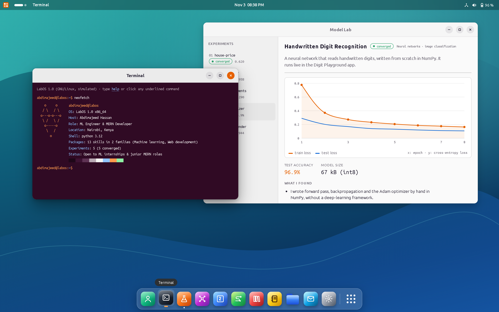
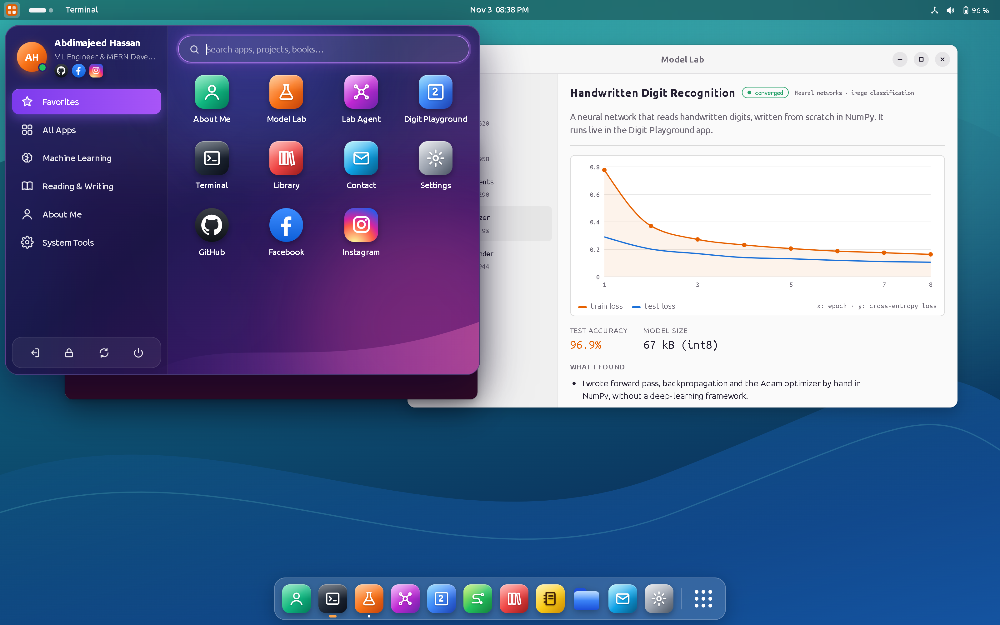
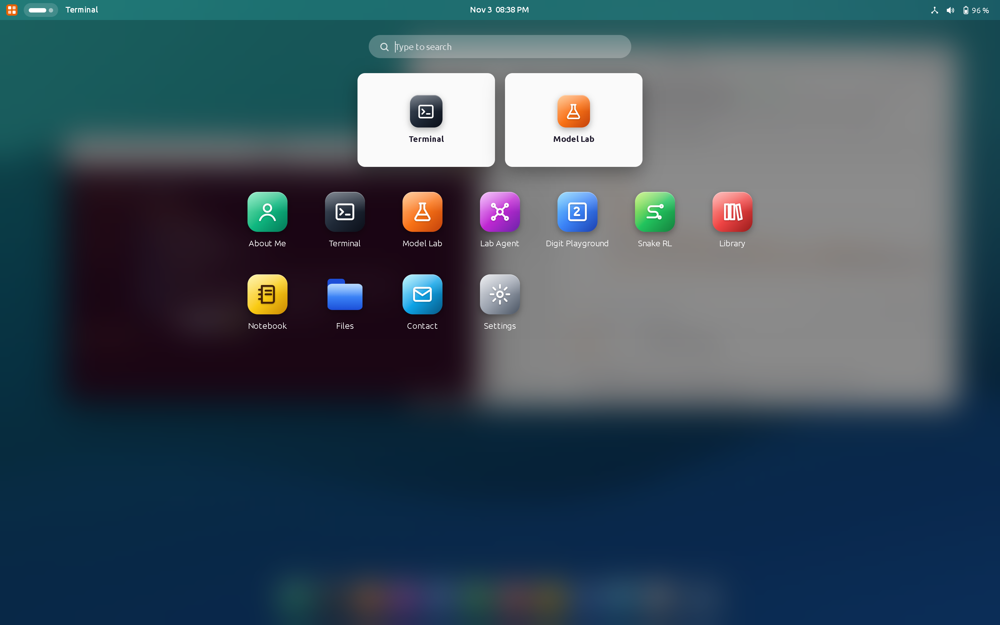
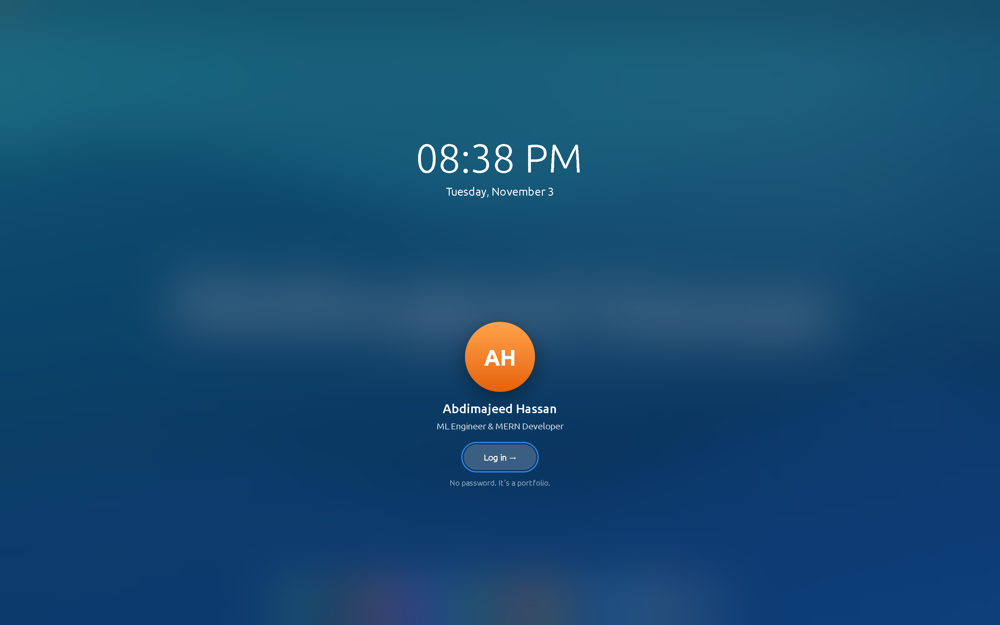
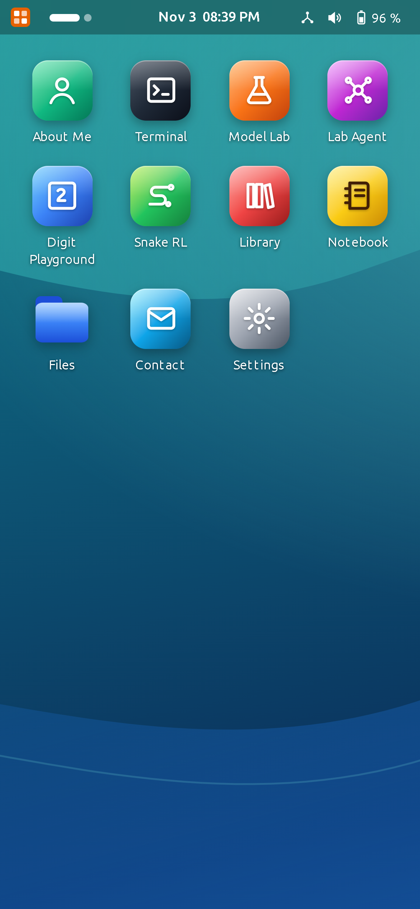
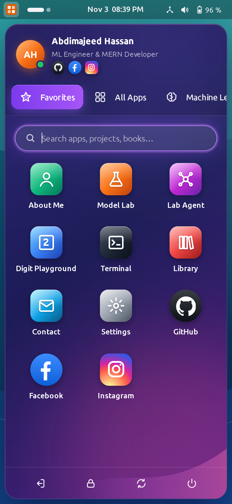

# LabOS: my portfolio as a Linux desktop

My portfolio is a whole operating system that runs in the browser. You log in, open apps from the dock, drag windows around, use a real terminal, and try machine learning models I trained.

**Abdimajeed Hassan**, ML Engineer & MERN Developer, Nairobi, Kenya. Open to ML internships and junior MERN roles.

## What's inside

- **Model Lab:** my five ML projects with their training curves, metrics and notes.
- **Digit Playground:** draw a digit and a neural network I wrote from scratch in NumPy reads it live.
- **Lab Agent:** an AI assistant that answers questions about my work.
- **Terminal:** a working shell. Try `neofetch`, `help` or `sudo hire-me`.
- **Library:** the books that shaped how I think, shelved by topic.
- **Settings:** themes, dark mode, translucent windows and brightness.

## Screens

| App menu | Activities overview |
| --- | --- |
|  |  |

| Login | Desktop |
| --- | --- |
|  |  |

It also works on phones:

  
  

## Built with

React 19, Vite, Tailwind CSS 4, Motion, Recharts and Python (NumPy, scikit-learn) for the models.

## ML projects (open source)

- [movie-recommender](https://github.com/abdimajeet/movie-recommender)
- [digit-recognizer](https://github.com/abdimajeet/digit-recognizer)
- [customer-segmentation](https://github.com/abdimajeet/customer-segmentation)
- [spam-detection](https://github.com/abdimajeet/spam-detection)
- [house-price-prediction](https://github.com/abdimajeet/house-price-prediction)

## Contact

- Email: abdimajitthassan@gmail.com
- GitHub: [abdimajeet](https://github.com/abdimajeet)
- Instagram: [apdimajitthassan](https://www.instagram.com/apdimajitthassan/)
- Facebook: [profile](https://www.facebook.com/share/18E2UWovBm/)

## Source code

The source code is private. This repository only shows what LabOS looks like.

© 2026 Abdimajeed Hassan. All rights reserved. You may not copy, reuse or redistribute the design, code or images without my written permission.
